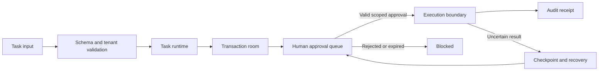

# Human-in-the-Loop Agent Operations Architecture
**Amy V · Full-Stack & AI Systems Engineering**

A public design study of controlled agent execution: approval is a scoped, expiring authorization for one action, not a boolean permission to execute anything.

## Decisions that matter
- Bind approvals to tenant, task, revision, exact arguments and expiry. An altered task requires fresh approval.
- Evaluate role and tenant boundaries before transitioning to approved execution.
- Reserve an execution identity atomically before any side effect. The included pure validator does not provide a database lock or one-time consumption.
- Recover uncertain executions through reconciliation; never assume a retry is harmless.

## Inspect and run
`python -m unittest -v`

`module.py` demonstrates approval validation; `schemas/approval-contracts.ts` documents the public shape. See [verification](docs/verification-ledger.md) and [publication boundary](docs/publication-boundary.md).

## Integration boundary
The caller authenticates the human, loads authoritative server-side state, checks approval revocation, consumes approval transactionally and writes the audit event. Hashing arguments binds content; it does not authenticate approval records. This small model deliberately does not execute tools.
